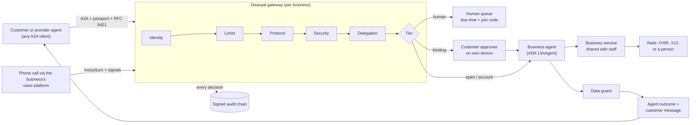

# Dwarpal · द्वारपाल

**Gate the action, not the caller.** One policy for every AI agent that calls your business, on the phone or over A2A. Built on Google ADK and A2A.

Customers and providers are starting to send AI agents to deal with businesses: *"call the clinic and move my appointment"*, *"chase that prior auth"*. More and more often, the business answering is an AI agent too. Guessing *who* is calling (human or bot, good bot or bad) will always be wrong some of the time. So Dwarpal (Hindi for *gatekeeper*) decides by *what is being asked*. Every action in a business's policy declares the proof it needs, and the gateway enforces it the same way on every channel:

| Tier | Example | Proof required |
|---|---|---|
| **Open** | Clinic hours, published prior-auth rules | None. Anonymous agents welcome; no personal data ever comes back |
| **Account** | Appointment status, PA status, eligibility | A verified agent passport with the right scope (on the phone: the business's IVR verification) |
| **Binding** | Cancel, refund | Passport **plus the customer's own approval of this exact action**, on their own device |
| **Human** | Disputes, medical records, new PA submissions | Always a person. The gateway opens a ticket with a due time and a join code |

Being honest about being an agent buys speed. Pretending buys nothing, because binding actions need the customer either way.

## What it does

**Every request passes eight checks**, and stops at the first one that refuses it:

| Check | How |
|---|---|
| **Identity** | Ed25519 *agent passport* from an issuer the business trusts, bound to the agent's own key. Every request signed with **RFC 9421 HTTP Message Signatures** (Content-Digest, nonce, 60-second window), so stolen passports and captured requests are useless |
| **Protocol** | Structured intents only; free text gets the catalog back; the caller's words never reach the business agent |
| **Security** | Layered prompt-injection shield: normalised rules (including base64 and zero-width smuggling), then Gemini, then Google Cloud Model Armor |
| **Delegation** | Scopes and money limits from the passport, intersected with business policy, checked before anyone is asked to approve anything |
| **Step-up** | For binding actions, an approval bound to the exact action, single-use and expiring. Method strengths in policy; a voiceprint is capped at 1 in code; there is always a path without speech |
| **Escalation** | Human-tier actions and runaway agents (turn, cost, loop, rate, probing limits) go to a person; repeat pushes reuse the ticket; the agent is told when to retry |
| **Data guard** | Fields that must never leave (diagnoses, SSNs, addresses) are dropped and PII redacted from every response |
| **Audit** | Hash-chained, signed log of every decision, approval and business call; signed receipts that cover what the customer was told |

**Across channels**
- **Phone lane.** The business's own voice platform (an IVR or CX Agent Studio agent) calls `/voice/turn` each turn. Carrier attestation and AI-voice scores are *signals*: they can add friction, never unlock anything, never block. Audio and transcripts are dropped on arrival. → [voice integration](docs/voice-integration.md)
- **"Press 1 if you're a robot."** A declared agent gets a spoken lane code to continue over A2A with its passport, carrying the call's context.
- **A2A extension.** The passport, signing profile and tiers are published as an A2A extension in every agent card. → [extension spec](docs/extension-agent-passport.md)

**For the business**
- **No privileged path.** Agents and staff change records through the same business service; the gateway has no write access.
- **Two messages per response.** A machine-readable outcome for the agent, and a customer message from the business's own templates, hashed into the receipt so a relay can be checked.
- **Many businesses, one gateway.** Each business is a kit (policy, service, ADK agent) with its own prefix, agent card, voice endpoint, keys, audit chain and dashboard.
- **Pilot metrics.** Agent share, outcomes, attacks stopped, approvals, handoffs, lane switches, rails used and estimated phone time avoided, all computed from the signed audit chain.

## Two demo businesses

**Sunrise Family Clinic** (`/`): patients' agents. **Brightline Health Plan** (`/payor/`): providers' agents checking prior auths and eligibility, with each plan answering on the rails it really has: a FHIR PA API for Medicare Advantage (real HTTP calls to a bundled Da Vinci PAS-style server, or your own), X12 278/270 for commercial (simulated clearinghouse), and a person for a plan with no electronic inquiry. If the FHIR API is down, the next rail answers. The clinic from the first demo is the provider calling the payor. → [payor desk](docs/payor-desk.md)

26 scenarios cover both: rescheduling, step-up on stage, approvals that can't be reused, money limits and cloned voices, prompt injection, forged and replayed requests, disputes and join codes, loops, the phone lane (people, honest agents, pretenders, a speech-device user, carrier signals), FHIR, X12 and fallback rails, provider-scoped lookups, and a provider's voice bot switching lanes.

## Quickstart

```bash
git clone https://github.com/akshaynara/dwarpal && cd dwarpal
python -m venv .venv && source .venv/bin/activate
pip install -e ".[dev]"

pytest                  # 124 tests
dwarpal doctor          # checks the install, Gemini if configured, and one end-to-end scenario
dwarpal demo            # every scenario in the terminal (add -v to see every check)
dwarpal serve           # http://localhost:8080 (clinic) and http://localhost:8080/payor/ (payor)
```

Settings can also live in a `.env` file in the folder you run `dwarpal` from (copy `.env.example`); it is git-ignored. It runs fully offline by default: the business agents are real ADK `LlmAgent`s with tools, driven by a scripted model. For Gemini:

```bash
export GOOGLE_API_KEY=...                 # or GOOGLE_GENAI_USE_VERTEXAI=true + GOOGLE_CLOUD_PROJECT
export DWARPAL_MODEL=gemini-flash-latest
dwarpal doctor                            # confirms a real Gemini round trip, or names a model that works
dwarpal serve
```

On stage, press **Ask Riya to approve, live** on the clinic dashboard: the request stops at the step-up pillar, an approval appears on the patient's phone card, a voiceprint alone isn't enough, the keypad PIN finishes it, and **Check the relay** proves the receipt matches what Riya was told.

## Commands

| Command | |
|---|---|
| `dwarpal serve` | Gateway, dashboards, A2A and voice endpoints |
| `dwarpal demo [--business payor] [--only id ...] [-v]` | Run scenarios in the terminal |
| `dwarpal doctor [--quick]` | Self-check, including a real Gemini call when configured |
| `dwarpal keygen --out key.pem` | Ed25519 key for an issuer or an agent |
| `dwarpal issue-passport ...` | Issue an agent passport for a pilot |
| `dwarpal pas-server [--port 8090]` | The bundled PAS-style FHIR server on its own |
| `dwarpal verify-audit` | Re-verify the audit chain from disk |

## How a caller talks to Dwarpal

Standard A2A JSON-RPC. Discover the gateway at `/.well-known/agent-card.json` (or `/payor/.well-known/agent-card.json`), activate the passport extension, send one DataPart, and sign the HTTP request:

```
POST /a2a
Authorization:   AgentPassport <passport>
A2A-Extensions:  https://github.com/akshaynara/dwarpal/blob/main/docs/extension-agent-passport.md
Content-Digest:  sha-256=:...:
Signature-Input: sig1=("@method" "@authority" "@path" "content-digest" "content-type" "authorization");created=...;keyid="...";alg="ed25519";nonce="...";tag="dwarpal-agent"
Signature:       sig1=:...:

{"intent": "cancel_appointment", "params": {"appointment_id": "APT-501", "reason": "travelling"}}
```

The reply carries the outcome, every check with its reason, the agent outcome (reason codes, next steps, retry-after), the customer message, and where relevant a signed receipt, a ticket and join code, or a step-up challenge to resend with once the customer approves. `examples/call_gateway.py` and `dwarpal/demo/callers.py` are working clients.

## Architecture



Everything a business decides lives in its policy file ([clinic](src/dwarpal/policies/sunrise_clinic.yaml), [payor](src/dwarpal/policies/brightline_payor.yaml)). Details: [architecture](docs/architecture.md).

## Deploying

Demo mode trusts the demo identities and opens the dashboard. **Production mode** (`DWARPAL_MODE=production`) trusts only issuers whose public keys are in the policy, turns demo endpoints off, requires an admin token for the dashboard and admin API, and accepts step-up approvals only from your identity provider. Tickets, approvals, lane codes and seen nonces persist in SQLite. → [deploy guide](docs/deploy.md), including Cloud Run and an honest note on state.

| Variable | Default | |
|---|---|---|
| `DWARPAL_MODE` | `demo` | `production` for real deployments |
| `DWARPAL_ADMIN_TOKEN` | unset | Required in production |
| `DWARPAL_IDP_KEY` | unset | Your identity provider's key for step-up callbacks |
| `DWARPAL_CHANNEL_KEY` | generated | Your voice platform's key for `/voice/turn` |
| `DWARPAL_LLM_MODE` / `DWARPAL_MODEL` | `auto` / `gemini-flash-latest` | Gemini when credentials exist, else scripted |
| `DWARPAL_LLM_TIMEOUT` | `20` | Seconds to wait for Gemini before the scripted fallback answers |
| `DWARPAL_BUSINESSES` | `clinic,payor` | Which businesses to mount |
| `DWARPAL_POLICY` | built-in | Your policy file for the default business |
| `DWARPAL_DATA_DIR` | `.dwarpal` | Keys, audit chain, state |
| `DWARPAL_STATE` | `sqlite` | `memory` to keep nothing between restarts |
| `DWARPAL_PUBLIC_URL` | `http://localhost:8080` | URL advertised in agent cards |
| `DWARPAL_MODEL_ARMOR_TEMPLATE` | unset | Adds the Model Armor layer |
| `DWARPAL_PAYOR_FHIR_URL` / `_TOKEN` | bundled server | A real FHIR PA API for the payor |

## What's simulated, plainly

The demo businesses, their records and the X12 clearinghouse are simulated. The FHIR rail makes real HTTP calls, to the bundled PAS-style server unless you point it at a real one. Passports come from demo issuers unless you configure your own. Session counters are in memory, and the SQLite store is single-instance; the deploy guide covers swapping in shared storage and Cloud KMS.

## License

Apache 2.0. Built by [Akshay Nara](https://linkedin.com/in/akshaynara), shaped by practitioner feedback from contact-centre, healthcare and voice-security people.
